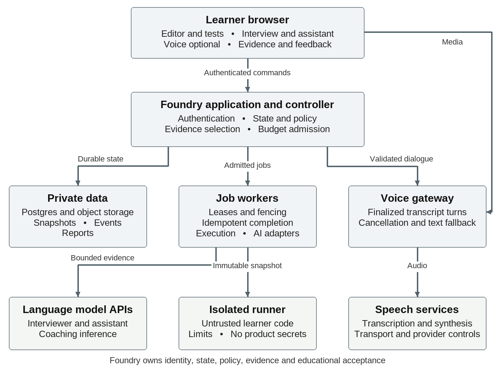
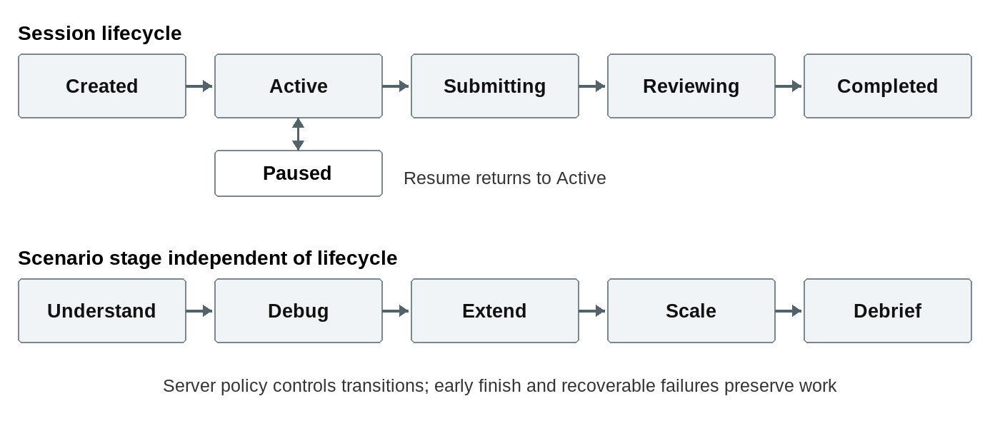

# Engineering Foundry AI Interview Practice Roadmap and Technical Design

Version 1 • October 9, 2026 • Proposed product and technical design


Build a focused practice experience for engineering interviews that combine unfamiliar code, debugging or feature development, permitted AI assistance, and discussion of the learner's decisions. Start by adding an adaptive conversational debrief to the existing invoice exercise. Extend that foundation into a hosted practice beta before expanding formats and language coverage.

The proposed learning loop is attempt, explain, receive feedback, practise a weakness, and demonstrate improvement on an unseen task. Its value depends on the relevance of the questions and the accuracy of the feedback. A natural voice experience helps realism, but neither voice nor a large question catalog can establish learning value by itself.

Launch does not require training a foundation model, speech model, or proprietary scoring model. Buy language and speech inference and managed infrastructure. Build the interview policy, original exercises, evidence contracts, feedback validation, and curriculum progression in house. Commission bounded implementation and content work when that accelerates delivery, while retaining first party ownership of product rules and quality acceptance.

The existing local Interview Lab provides a practical foundation. It already executes an original Python exercise, records test and AI edit evidence, and requests educational coaching. Its interview sequence is scripted, its persistence is local, and its current feedback has not been shown to improve learning outcomes. The main application has useful account, content, mock review, progress, and runner patterns; their existence in source does not establish hosted qualification for this new workload.

Plan for a text alpha in 2 to 3 weeks, a narrow hosted beta in 8 to 12 weeks, and a more reliable paid release in 3 to 5 months. These are cumulative estimates from an agreed project start, with two engineers, an experienced technical interviewer or content author, and shared design support. They assume modest initial concurrency, one primary runtime, three to five original scenarios, and reuse of suitable existing infrastructure. The beta excludes a full cloud IDE, arbitrary repository imports, a general autonomous coding agent, and broad language coverage.

## 1 Scope and evidence conventions

The target customer is an individual preparing for interviews. Employer screening, ATS integration, proctoring, biometric analysis, and automated hiring decisions are outside the proposed product. Employer names and platform formats can provide context, but Foundry should publish original exercises and describe simulations as preparation rather than exact reproductions or official hiring evaluations.

This is a proposed design, not a claim that the described capabilities are deployed. Existing means observed in repository source or its supporting documentation. Proposed means a design or target to implement. Unverified means that source inspection did not establish runtime behavior, deployment, commercial access, or quality. All performance thresholds, dates, staffing estimates, retention defaults, and budgets below are proposed planning values unless explicitly attributed to a verified source.

Repository inspection used the Engineering Foundry working checkout on October 9 2026. The inspected checkout reported HEAD 80a55330571bcb87dd9538071f8c8e8bc68b3f70 and substantial working tree changes, including the untracked Interview Lab. Therefore, this document describes a working snapshot, not a reproducible commit or the production deployment. The implementation team should first establish an agreed base branch and record the exact versions being integrated.

Official service documentation and prices were checked on October 9 2026. Prices can change and can depend on model, region, context size, plan, cached tokens, and usage. A published capability does not establish access or an applicable service commitment for Foundry's account. Source identifiers in the text map to the reference register at the end.

## 2 Decisions to make before implementation

| Decision | Recommended starting point | Condition to revisit |
| --- | --- | --- |
| Initial audience | Mid level backend engineers preparing for practical coding and AI assisted interviews | Learner research identifies another format with stronger demand |
| First language | Python using the existing invoice exercise | A verified customer cohort needs another runtime |
| First AI increment | Typed adaptive debrief of submitted work | Relevant, grounded dialogue passes the alpha evaluation |
| Beta workspace | Bounded multi file editor with tests and diffs | Larger tasks demonstrably require a terminal or full IDE |
| Interview policy | Fixed task contract and required coverage with bounded adaptive probes | Evidence shows a particular branch improves learning without giving away solutions |
| Voice | Optional channel over the same interview controller | Reliable transcripts and measured cost justify wider rollout |
| Exercise selection | Authored catalog with difficulty and skill tags | Catalog size and usage justify more sophisticated recommendation |
| Model strategy | Benchmark the existing low cost baseline and a stronger candidate | Quality or cost data supports a change |
| Report | Criterion findings with evidence and a concrete next practice step | Sufficient validation supports additional summary measures |
| Initial commercial model | Metered session entitlement with explicit voice and AI budgets | Measured usage supports a broader subscription allowance |

## 3 Learner experience

The core loop is choose → attempt → explain → review → drill → retry. A learner selects role, level, target skill, duration, and whether AI assistance is allowed. A setup screen explains the exercise format, recording choices, help policy, and interruption recovery. A short equipment check is required only when voice is selected.

During an interview, the learner explores a repository, asks clarifying questions, edits files, runs tests, and selects Finish coding. This freezes the code while the session remains active for discussion. The interviewer knows the rubric and current stage, asks one relevant question at a time, and probes evidence at explicit checkpoints. It should not interrupt every keystroke or demand constant narration. The learner can indicate “working,” request clarification, or ask to repeat a question. In practice mode, hints and pauses are available; in simulation mode, timing and assistance rules are fixed in advance.

During the frozen-code debrief, the interviewer asks about the actual implementation: omitted edge cases, failing tests, trade-offs, and alternative approaches. Final submit ends this discussion and freezes the complete evidence set, including the learner's answers. Only then does the coach generate a report with dimension-specific findings, exact evidence references, uncertainty, and concrete next steps. A learner can open the cited code snapshot or transcript turn, disagree with a finding, or report a technical error. The next attempt should use a fresh scenario testing the same competency when available, while repeats remain useful for deliberate practice.

## 4 Feature inventory and acceptance criteria

P0 means required for the first useful adaptive alpha; P1 means required for a hosted beta unless marked conditional; P2 means expansion after validation. These priorities are proposed scope decisions.

| Capability | Priority | Implementation and acceptance criterion |
|---|---|---|
| Interview configuration | P0 | Select authored scenario, level, length, and assistance policy. Persist the exact configuration and scenario version on session creation. |
| Repository workspace | P0 | Reuse the current workspace where sound; add clear file navigation, editor, test output, and submission checkpoint. Browser refresh must recover the last acknowledged files. |
| Execution and test evidence | P0 | Run tests in isolated execution; record run ID, code snapshot, command, exit status, limits, and output. Every correctness claim references a real run or is labeled unverified. |
| Adaptive text debrief | P0 | Generate bounded follow-ups from submitted code, test evidence, and the rubric. Demonstrate relevant probing on correct, partial, wrong, and ambiguous attempts. |
| Distinct AI roles | P0 | Separate tool access, prompts, and context for interviewer, coding assistant, and coach. Assistance never silently edits files or exposes the scoring reference. |
| Evidence-linked feedback | P0 | Return structured findings, supporting evidence, confidence, and one to three next actions. Missing evidence produces “not observed,” not an invented negative. |
| Practice/simulation modes | P1 | Clearly separate hints, pausing, time extensions, and answer reveal rules. Reports record help used; accessible interaction modes are not penalized. |
| Session history and recovery | P1 | Authenticated learner can resume, review completed attempts, and delete their history. Retries do not duplicate application edits, stages, or entitlement debits. Interrupted vendor inference may still be billed and must be reconciled. |
| Scenario catalog | P1 | Publish three to five reviewed original scenarios with metadata, reference solutions, tests, rubric anchors, drills, and retirement/version rules. |
| Live voice | P1, conditional | Optional transcript-backed conversation with microphone check, repeat, interrupt, and text fallback. Voice failure preserves workspace and session progress. |
| Skill progression | P1 | Map findings to Foundry lessons and drills; distinguish repeated and unseen tasks. Show a provisional skill profile with evidence counts and last observation dates. |
| Entitlements and spending limits | P1 | Enforce session/minute quotas server-side, rate limits, and per-session cost caps. Explain exhausted quota before losing work. |
| Internal review tools | P1 | Author previews a scenario; reviewer inspects anonymized approved evaluation examples, rubric disagreements, and report failures. Roles restrict learner-data access. |
| Operational support | P1 | Trace sessions end-to-end, flag broken runs or missing reports, regenerate safely, and offer a support reference without exposing private code in logs. |
| System-design interviews | P2 | Add structured artifacts and architecture trade-off rubrics after validating the code workflow. Drawing requires separate UX and evidence handling. |
| Behavioral interviews | P2 | Add evidence-based narrative coaching without personality, emotion, accent, or employability inference. |
| Languages and frameworks | P2 | Add one runtime at a time with authored equivalents, execution images, limits, tests, and rubric validation. Syntax translation alone is insufficient. |
| Human review and cohorts | P2 | Optional mentor feedback and cohort practice; permissioned sharing with expiration. Peer mode remains available independently of autonomous interviewing. |
| Personalized study plans | P2 | Recommend tasks from observed gaps, available content, and learner goals; validate improvement before making mastery claims. |

## 5 Content production and learning design

Treat each scenario as a versioned product package: learner brief; starter repository; runtime image; public and protected tests; reference solutions; known broken approaches; rubric criteria with positive and negative anchors; stage plan; follow-up bank; graduated hints; explanation; prerequisite lessons; and related drills. Store source in version control and publish immutable packages. Sessions retain their original version even when authors improve the next release.

The initial catalog should cover distinct capabilities rather than five cosmetically different copies: debugging monetary calculations and validation; extending behavior without regressions; retries and idempotency; concurrent processing and data consistency; and an unfamiliar repository combining several skills. A scenario may cover multiple criteria, but every criterion needs an observable task or question. Specify which tests are protected and why; do not rely on secrecy as the only barrier to memorization.

Use three difficulty levels through constraints and expected reasoning. Junior variants emphasize correctness and tests. Mid-level variants add integration, failure modes, and justified choices. Senior variants add uncertainty, operational consequences, and concurrency trade-offs. Keep the rubric tied to observable work, not verbosity or resemblance to one reference answer. Accept multiple valid implementations.

Budget approximately three to five expert working days per substantial scenario for a first reviewed version, plus revision after trial sessions. This estimate can grow for concurrency or system-design tasks. Contract authors can draft packages, but Foundry should retain editorial ownership, final approval, reusable templates, and rights to distribute and modify the work. Never source tasks from leaked interviews or assume public questions permit republication.

## 6 Existing foundations and integration map

| Verified source | Current behavior | Proposed use / boundary |
|---|---|---|
| `interview-lab/lib/interview.mjs`: `stages`, `debriefQuestions`, `buildEvidence` | Five authored stages; debrief chooses questions from the latest test outcome and accepted AI edits; evidence includes code, test snapshots and bounded activity | Reuse the scenario and evidence concepts; replace scripted debrief with bounded dialogue before adding live coding prompts |
| `interview-lab/lib/ai.mjs`: `assist`, `reviewAttempt` | Separate coding assistant and educational coach; structured responses; validates referenced evidence IDs; missing explanations become “Not observed” | Extract provider adapter, schemas and coaching rules into server-only TypeScript modules |
| `interview-lab/server.mjs`: `useAI`, `save`, `createServer` | Local JSON persistence; per-attempt request/cost reservations; cookie identity; process-local operation lock | Preserve reservation-before-call behavior; replace local persistence and lock with authenticated transactional storage |
| `interview-lab/lib/runtime.mjs`: `bundle`, `execute` | Fresh constrained Docker container; optional remote adapter; tests and learner code share a Python process | Keep local development adapter; qualify hosted execution separately |
| `interview-lab/lib/mission.mjs` | Hardcoded duplicate-invoice mission, file allowlist, reference and deterministic summary | Generalize into versioned scenario packages |
| `app/mock-interviews/actions.ts`: `saveMockInterviewReview` | Authenticated solo/peer review saving through `save_mock_interview_review` | Preserve existing self/peer provenance; add AI session storage rather than changing historical meaning |
| `lib/mock-interviews/session-conditions.ts` | Fresh/repeated exposure, timing, hint policy, assistance and technical-failure conditions | Reuse vocabulary; keep explicit conditions on new attempts |
| `lib/auth/actor.ts`: `getAuthenticatedActorState`, `getAuthenticatedActor` | Verified owner resolution distinguishes anonymous and unavailable states | All private API ownership comes from this actor, never a submitted user ID |
| `lib/dsa/judge/repository.ts`, `worker.ts` | Admission fingerprints, request-key conflicts, claims, leases, heartbeat and fencing; injected execution dependencies | Reuse orchestration patterns, not the DSA-specific schema or algorithm harness |
| `services/code-runner/src/index.ts`, `protocol.ts` | Source defines isolated execution, disabled public egress, authentication, limits and cleanup | Candidate hosted boundary; actual deployment and lab compatibility remain unverified |
| `lib/account/export.ts`: `buildAccountExport`; `features/account/actions.ts`: `deleteAccountAction` | Private export; account deletion cleans referral uploads before deleting the auth user | Extend export and storage cleanup for interview artifacts |
| `lib/interview-playbook/mock-evidence.ts`: `mockReviewsToInterviewEvidence`; `lib/review-queue/adapters/specialists.ts` | Existing mock reviews enter planning/review flows with self-report provenance | Add a distinct AI-coaching adapter; never label generated feedback as verified peer assessment |

The standalone lab has no captured speech, live interviewer conversation, cross-attempt picker or hosted account integration. Its phase changes are user actions. Existing runner language definitions do not prove every language supports a repository exercise. Current package versions are implementation context, not deployment assurance.

## 7 Proposed components and ownership



The diagram shows service boundaries and primary flows. Return paths and retries use the contracts below.

Use a modular monolith plus bounded workers, not a microservice for every model role:

1. **Next application:** proposed `app/interview-practice/` routes and `features/interview-practice/` workspace. Reuse approved Foundry UI components and tokens when implementation begins.
2. **Domain module:** proposed `lib/interview-practice/` for scenario contracts, state transitions, authorization, evidence selection and report validation. Keep this code independent of provider SDKs.
3. **Session API:** authenticated admission, autosave, transcript commits, commands, exports and event replay. Business mutations call transactional database functions.
4. **Interview orchestrator:** selects the next competency/probe within an authored plan. The model proposes a question; server policy decides whether it is allowed.
5. **AI adapters:** separate interviewer, coding-assistant and coach configurations behind one provider interface. They may use the same base model. Providers never own session state.
6. **Job worker:** executes tests, generates reports and reconciles usage with leases and fenced completion. Initially use a Postgres jobs table and worker loop; introduce a separate queue only when measured throughput justifies it.
7. **Voice gateway:** long-lived stream handling, endpoint detection, interruption and speech transport. Separate deployment boundary from request-oriented pages/API handlers.
8. **Private storage:** immutable workspace snapshots, report artifacts and optional audio. Postgres owns authorization and metadata; object storage holds larger blobs.

The interviewer cannot edit files, install dependencies or execute arbitrary commands. The coding assistant can propose allowlisted edits; the learner accepts them. The coach runs after final submission, once the debrief evidence is frozen, and provides explanations, exercises and next-practice links. This separation keeps the simulation's assistance rules explicit.

## 8 Scenario package and session state machine



Create a reviewed package per scenario: `manifest.json`, starter files, runtime profile, visible tests, separately held checks, reference solution, rubric, misconception map, authored probes, hints, clarifications and source/rights metadata. Pin `scenarioVersion`, `rubricVersion`, test/harness digests and runtime image digest on admission. Never reinterpret an old attempt using a newly edited rubric.

The first package remains Duplicate Invoice Incident. Generalize file names, stages and test loading before adding scenarios. DSA, behavioral and design practice can later use the same session/evidence layer through different workspace and evaluation adapters; they do not all need a code runner.

Use two state axes. **Lifecycle:** `created → active ↔ paused → submitting → reviewing → completed`; alternatives include `abandoned` and `deleting`. Recoverable service failures are operation states, not a low learner grade. **Stage:** scenario-defined sequence such as `understand → debug → extend → scale → debrief`. Practice and simulation modes share requirements while differing in hints and timing.

Finish coding (`finish`) freezes `code_frozen_snapshot_id` and enters the debrief stage while lifecycle remains active. Deterministic checks may run against that snapshot to inform questions. Final submit (`submit`) closes dialogue, freezes an evidence manifest and committed event watermark, advances lifecycle through submitting to reviewing, and admits the coaching job. The report cannot race ahead of the learner's final explanations. Further edits require an explicit new attempt or a separately designed reopen operation.

Only server commands advance lifecycle/stage. The model can request `ask_probe`, `clarify`, `offer_stage_transition` or `end_debrief`; policy validates allowed actions, required coverage, time budget and probe count. Allow early finish with incomplete code. Timers are advisory initially; zero time never destroys work. Record accommodations and timing settings rather than infer ability from speed.

Start with frozen-code debrief: one prompt, one answer, one follow-up at a time, usually three to six turns. Full-session prompts later occur after a learner request, explicit checkpoint or meaningful test outcome. Avoid interrupting typing and avoid treating every failed experiment as a mistake.

## 9 Typed contracts and evidence model

Proposed TypeScript contract excerpts:

```ts
type EvidenceRef = {
  id: string; kind: 'snapshot' | 'test' | 'utterance' | 'edit-decision';
  artifactId: string; selector?: string; sha256: string;
};
type PracticeCommand = {
  requestId: string; expectedRevision: number;
  action: 'advance' | 'pause' | 'resume' | 'finish' | 'submit';
};
type InterviewProposal = {
  action: 'ask_probe' | 'clarify' | 'offer_stage_transition' | 'end_debrief';
  competencyId: string; probeId?: string;
  question: string; evidenceIds: string[];
};
type PracticeEvent<T> = {
  id: string; sessionId: string; sequence: number; schemaVersion: 1;
  type: string; occurredAt: string; recordedAt: string;
  source: 'learner' | 'server' | 'runner' | 'model';
  requestId: string; causationId?: string; payload: T;
};
```

Implement events as a validated discriminated union, not arbitrary JSON. Initial event names: `session.started`, `workspace.saved`, `test.requested`, `test.completed`, `assistant.edit-proposed`, `assistant.edit-decided`, `interviewer.question`, `learner.answer-committed`, `stage.changed`, `coding.finished`, `session.submitted`, `coaching.ready` and `operation.failed`.

Server sequence is the replay order; client time is supplementary. Store periodic complete snapshots and save acknowledgements, not every keystroke. Snapshot hashes use canonical sorted paths plus UTF-8 file contents. Test evidence always identifies the executed snapshot, suite and runtime. Transcript evidence distinguishes typed, machine-transcribed, learner-corrected and learner self-report. Speech drafts are not final evidence.

Reports contain criterion ID, `Strong | Developing | Needs work | Not observed`, bounded feedback, evidence references, observation limits and next-practice IDs. Test facts and model interpretation remain separate. Do not generate a universal “Chakra score,” passing probability or percentile without an independently justified basis.

## 10 Proposed database schema, RLS and deletion

Use new tables rather than widening existing self/peer review semantics. Names below are proposed:

| Table | Key columns and constraints |
|---|---|
| `practice_scenario_versions` | `(scenario_id, version)` primary key; immutable manifest/digest; publication state; no learner data |
| `ai_practice_sessions` | `id`, `user_id → auth.users ON DELETE CASCADE`, scenario/version, mode, exposure, timing/hint settings, lifecycle, stage, revision, code-frozen snapshot ID, final evidence manifest digest/event watermark, consent version, timestamps |
| `ai_practice_snapshots` | `id`, `session_id`, `user_id`, sequence, content hash, storage key, byte count; unique `(session_id, sequence)` |
| `ai_practice_events` | `id`, `session_id`, `user_id`, sequence, event type/schema, payload, request/causation IDs, timestamps; unique `(session_id, sequence)` and event ID |
| `ai_practice_jobs` | `id`, session/owner, kind, input snapshot, fingerprint, state, attempt, lease expiry, claim/fencing tokens, cancellation flag, safe error, timestamps |
| `ai_practice_ai_calls` | call/job/session/owner IDs, role, provider/model identifier, prompt/schema version, reserved/actual usage, status, provider request ID; unique logical operation ID |
| `ai_practice_reports` | report/session/owner IDs, frozen code snapshot, rubric/model/prompt versions, validated report, final evidence manifest/digest, generation identity; immutable report generations |
| `ai_practice_artifacts` | artifact/session/owner IDs, kind, private storage key, digest, size, retention deadline and deletion status |
| `ai_practice_requests` | `(user_id, request_id)` unique; operation, canonical input fingerprint, response/job ID and expiry |
| `ai_practice_usage_ledger` | owner, operation ID, reservation/settlement type, units, estimated money, timestamp; unique posting key |
| `ai_practice_deletions` | cleanup ID, opaque owner/session reference, inventory of storage objects and server-staged exports, state, retries, expiry; deliberately no cascading owner/session FK |

All session children carry `user_id` for indexed policies and use a composite foreign key `(session_id, user_id)` to prevent cross-owner references. Index owner plus creation time, session plus sequence, and queued jobs plus eligibility/lease expiry. Constrain enum values, nonnegative usage, bounded text/JSON size and valid lifecycle changes. Keep private checks outside public scenario manifests.

Enable RLS on every private table. Owner reads require `(select auth.uid()) = user_id`; anonymous access is denied. Direct client writes to jobs, usage, reports and authoritative events are denied. Authenticated mutation RPCs derive `auth.uid()`, validate ownership/revision and use an explicit empty search path with schema-qualified names. Trusted workers use restricted server credentials; every job carries an admitted owner and fencing token. Do not treat a service credential as permission to accept arbitrary client owner IDs.

Private object keys are server-generated, e.g. `owner/session/artifact`, and accessed only after ownership checks through short-lived signed URLs. Do not expose keys as authorization. Raw audio retention should be optional and short; default to storing only necessary transcript evidence, with an explicit user-facing choice if audio is retained.

Extend `buildAccountExport` with sessions, transcripts, snapshots, reports and usage summaries. Add an interview cleanup hook to the account lifecycle before deleting the auth user. A deletion transaction first tombstones access, cancels jobs and revokes streams; `ai_practice_deletions` preserves the storage inventory and retry state after account/session cascades. Restrict this minimal ledger to cleanup workers and expire it after verified cleanup and the documented audit window. Workers check the tombstone before saving output. Cascades clean relational children; they do not delete storage blobs or provider-side records. Delete server-staged exports; copies already downloaded by a learner cannot be revoked. Document backup expiry and provider deletion limits rather than promise immediate universal erasure.

## 11 APIs, concurrency and idempotency

Proposed API namespace: `/api/interview-practice`. Use the existing authenticated actor, same-origin mutation checks and bounded request parsing patterns. Never send model or runner secrets to the browser.

| Endpoint | Behavior |
|---|---|
| `POST /sessions` | Admit published scenario/version and mode; reserve entitlement; return session and revision |
| `GET /sessions`, `GET /sessions/:id` | Owner history and resumable authoritative state |
| `PUT /sessions/:id/workspace` | Allowlisted file save with expected revision; return snapshot/hash and new revision |
| `POST /sessions/:id/commands` | Validated transition: Finish coding freezes code and starts debrief; Final submit freezes complete evidence and admits coaching |
| `POST /sessions/:id/turns` | Commit typed/final speech answer; enqueue interviewer response |
| `POST /sessions/:id/runs` | Execute an identified immutable snapshot; return `202` and job ID |
| `POST /sessions/:id/assistant` | Ask/plan/edit; proposals carry the base snapshot hash |
| `POST /sessions/:id/edit-decisions` | Accept/reject proposal; reject stale accept or undo |
| `GET /sessions/:id/events?after=sequence` | Replay or SSE stream; authenticate every connection |
| `POST /sessions/:id/voice-ticket` | Admit a short-lived, session-scoped voice connection |
| `GET /jobs/:id`, `POST /jobs/:id/cancel` | Owner-visible status and best-effort cancellation |
| `POST /sessions/:id/reports`, `DELETE /sessions/:id` | Idempotent coaching retry; durable deletion workflow |

Mutations carry a request UUID. Same owner/key/fingerprint returns the original result; changed payload returns `409`. Workspace/state revisions use compare-and-swap, with stale writes returning `409` and current revision. Finish coding atomically pins the saved code snapshot and debrief stage. Final submit atomically freezes the complete evidence manifest/watermark, marks lifecycle submitting, and creates the coaching job. Final submission waits for admitted evidence-producing work or explicitly records its cancellation/absence; later callbacks cannot silently change the report input. Autosaves cannot alter frozen code or evidence.

Do not hold database locks across model, speech or runner calls. Admit and reserve in one transaction; perform external work; validate and commit under the claim token. Adopt the existing judge’s lease/heartbeat/fencing pattern for background work. Expired workers cannot overwrite a newer result. Exactly-once external inference cannot be assumed: an interrupted call may have incurred cost. Record it as uncertain, retain a conservative reservation, and reconcile where possible rather than issuing unlimited blind retries.

Limit concurrent interviewer responses per session, active sessions per account, daily/monthly AI usage, test runs, voice minutes and global provider spend. Use atomic ledger admission, not a browser counter. Allow saving and deterministic results when the AI quota is exhausted. Streaming output is provisional until a terminal event commits it; reconnect replays committed sequence IDs without duplicating messages.

## 12 Sandbox boundary and migration

The lab’s Docker controls are useful local safeguards: no network, no host mounts, read-only root, unprivileged user, bounded memory/processes/time/output and explicit cleanup. A snapshot fixes the executed input. It does not establish grading integrity: the in-process harness can be inspected or tampered with by deliberately hostile code.

For hosted practice, qualify the existing isolated runner boundary with repository fixtures, cancellation, timeout cleanup and concurrent users. The lab bundles a repository into one Python source submission; the existing remote protocol has a 50,000-character source limit and shorter execution windows. Do not assume this adapter supports the concurrency/restart exercise unchanged. Add a bounded repository-job protocol if necessary: allowlisted files, content digests, server-selected runtime image, immutable dependency set and resource profile.

Separate trusted comparison from learner execution where strong test integrity matters. For the SQLite exercise, some checks require imports and shared-process behavior; either redesign an observable input/output boundary or explicitly label these as coaching checks rather than tamper-resistant grading. Never place API credentials, private storage tokens or production data inside a sandbox. Do not grant package downloads or outbound network by default. New dependencies require curated images and a reviewed scenario version. Collect only bounded diagnostic output; terminate and destroy environments after completion, cancellation and lease loss.

## 13 Streaming voice and recovery

First implement text dialogue; then add press-to-talk voice with visible transcript and text fallback. Proposed flow: browser microphone → admitted voice gateway → speech recognition → final transcript → interview orchestrator → validated question → speech synthesis. Full-duplex speech is a later usability improvement, not a prerequisite for adaptive practice.

Keep long-lived WebSocket/media connections out of short-duration page handlers. A dedicated gateway maintains connection/turn IDs, heartbeat, cancellation and playback state; Postgres remains authoritative for finalized turns. Session-scoped short-lived tickets are issued by the authenticated app. If a future provider supports direct browser transport, qualify its credential scope and retention first; application secrets remain server-side.

Do not advance the interview on partial transcription. Let learners correct recognition before committing consequential answers. When interrupted, stop playback and generation as supported, mark the turn interrupted and avoid treating unheard content as delivered. On disconnect, retain saved code and committed turns, pause the conversation and resume from the last committed question. Speech/model failure falls back to text or authored questions; report unavailable evidence clearly. Measure end-of-speech-to-audio latency, interruption success, recognition correction rate, reconnect recovery and voice cost per completed session.

## 14 AI engineering and model development

### What building AI from scratch means here

Foundry needs to develop an application around pretrained models. Training the underlying model is a separate activity and is unnecessary for the first release. A language model supplies language and code reasoning; it does not supply Foundry's product policy, task correctness, teaching objectives, access control, or acceptable evidence. Those remain application responsibilities.

The three visible roles can share one provider and initially one model. Separate instructions, input views, allowed tools, and output schemas establish their boundaries. An interviewer must not receive the coach's full solution or permission to edit the workspace. The coding assistant must not issue authoritative evaluations. The coach receives a frozen attempt and explains observations after the session. A generic agent framework is optional; a small explicit controller is sufficient for the first workflow.

| Capability | We build and own | External capability | Training required at launch |
| --- | --- | --- | --- |
| Interview planning | Task sections, coverage, timing policy, seniority bounds, review workflow | Optional draft generation by an LLM | None |
| Adaptive questions | Trigger selection, evidence packaging, permitted probes, solution leakage checks, fallback questions | LLM proposes wording and follow ups | None |
| Coding assistance | Allowed file changes, preview, validation, stale edit protection, undo, usage rules | LLM explains or proposes code | None |
| Skill feedback | Rubric, observable criteria, evidence references, factual checks, uncertainty, corrections | LLM drafts the interpretation and feedback | None |
| Speech | Consent, microphone UX, transcript corrections, turn policy, text fallback | Managed transcription and speech synthesis or realtime speech | None |
| Code correctness | Test fixtures, reference solutions, isolated execution, trusted results | Managed sandbox compute | None |
| Learning progression | Skill tags, prerequisites, fresh task rules, drill mapping, comparable attempt history | Optional later embeddings or reranker | None |
| Content authoring | Original task contracts, tests, alternative solutions, probe bank, provenance and expert approval | LLM may assist drafting | None |

### Interviewer control loop

The application chooses when a question is appropriate, such as the learner requesting clarification, submitting a checkpoint, finishing a test run, or entering the debrief. It retrieves a bounded, versioned view of relevant evidence. The model returns a proposed action with a question, target competency, and evidence identifiers. Server validation checks the action against current state and coverage. Accepted dialogue is recorded; invalid output receives at most one repair attempt before an authored fallback.

Do not call the model on every keystroke. It increases cost, distracts the learner, and makes reasoning about consistency harder. The interviewer should remain quiet during most coding and ask questions at meaningful moments. A question about an alleged defect must reference the actual code or test observation. If evidence does not support the premise, the controller should ask neutrally or abstain.

Structured output improves the shape of a model response. It does not establish that the response is factually correct, educationally useful, or authorized. Refusals and incomplete responses also require explicit handling. Foundry must validate both schema and meaning before presenting an action. [R1]

### Grounding and retrieval

Begin with explicit retrieval by task version, file path, test snapshot, competency ID, and lesson ID. For three to five tasks, authored mappings and database queries are easier to inspect than a vector search service. Supply only the current requirements, allowed clarifications, relevant work excerpts, transcript turns, and evidence needed for the current action.

Keep reference solutions and hidden evaluator materials in a restricted authoring and grading boundary. They must never enter the coding assistant or interviewer context when their release would spoil the task. The coach can use approved teaching notes after submission. A generated summary is a convenience view; preserve its links to the original observations and never let it replace those observations as the source of truth.

When the curriculum becomes too large for reliable exact mappings, compare metadata search and full text retrieval with an embeddings approach on a held out query set. Add vector search only if it improves lesson relevance or reduces authoring burden. Store owned curriculum embeddings separately from private learner artifacts. User code and interview transcripts do not need to become a shared retrieval corpus.

### Choosing and routing models

Keep model choice in server configuration rather than in task logic. Benchmark the current lab baseline against one stronger candidate using the same evidence, rubric, and evaluation set. Compare factual accuracy, question relevance, solution leakage, feedback usefulness, latency, schema reliability, and cost. A cheaper model is acceptable only when it meets the same release criteria for its assigned role.

Routine clarification or question phrasing may use a smaller model. Complex final feedback may justify a stronger model. High uncertainty can trigger a stronger review, an authored explanation, or an explicit missing observation. A second LLM's agreement is not independent proof of correctness. Deterministic checks and expert review should adjudicate important disagreements.

Pin model identifiers where the provider supports it, record the exact requested and returned model information, and version prompts and policies. Provider failover should use a separately evaluated adapter. During a session, an uncontrolled model switch can change behavior; prefer preserving state and offering text or authored questions while the service recovers.

### Evaluation data before training data

Create a small reviewed benchmark before expanding the product. It should contain complete and incomplete solutions, plausible but wrong explanations, failed runs, successful runs, accepted bad AI edits, rejected good edits, sparse dialogue, unusual valid approaches, and technical interruptions. Separate task variants used for development from those used for acceptance and learning transfer.

Expert annotations should identify the observation, the warranted finding, the supporting evidence, the severity of an error, and an actionable next step. Measure agreement between reviewers and adjudicate disagreement. Include adversarial examples where code comments or learner answers ask the model to change its role or invent a result. Synthetic examples can broaden coverage; consented learner sessions reveal failure modes synthetic conversations miss.

Run the benchmark after changes to prompts, models, exercise contracts, retrieval, tools, or evidence construction. Track performance by scenario and learner conditions rather than only a single aggregate percentage. Official OpenAI evaluation guidance also recommends explicit objectives, datasets, metrics, comparisons, and continuous evaluation. Foundry's proposed thresholds are product choices, not vendor guarantees. [R4]

### When fine tuning could make sense

Fine tuning becomes a candidate only after prompt design, better examples, retrieval, and deterministic controls have reached a measured limit. Possible later targets include consistent feedback style, question classification, or a narrow rubric labeling task. It should not be used to compensate for faulty exercises or missing evidence.

A fine tuning proposal must identify the specific baseline failure, rights to the training data, annotation consistency, a held out evaluation set, expected quality or cost benefit, deployment and rollback method, and the recurring maintenance cost. Training and test sets must be separated by task family or variant where possible so memorization does not masquerade as generalization. The necessary dataset size depends on the task and measured learning curve; this design does not assume a magic number of examples.

There is no initial requirement for a GPU cluster, an ML research team, self hosted foundation model inference, custom speech recognition, facial analysis, or a proprietary hiring prediction model. A later trained recommendation model is optional. Begin with transparent rules: the learner's stated goal, prerequisites, demonstrated gaps, assistance used, and fresh tasks available.

### Data use and privacy defaults

Proposed default: preserve private attempts and reports until the learner deletes them; collect no webcam or screen recording; keep optional raw audio off unless the learner explicitly enables playback. If audio is enabled, start with seven days of replay availability and a published deletion process. Keep deidentified operational counters longer only under a documented purpose and retention policy. Validate these defaults against the actual providers and backup lifecycle before publishing them.

Treat permission to provide a practice service separately from permission to reuse a session for research or training. Make any optional research participation explicit and revocable for future collection. Redact accidental secrets and personal details before telemetry or model calls where practical. Never send another learner's attempt to a model as an example without appropriate permission and sanitization.

The local lab uses store false. That setting must not be described as a universal promise of zero provider retention. OpenAI documents endpoint specific application state and abuse monitoring policies, including standard retention periods and eligibility conditions for additional controls. Each speech, observability, and sandbox provider has its own policies. [R3]

## 15 External services and operating costs

### Recommendation and build-versus-buy boundary

Launch text-based repository practice on the existing application stack. Keep OpenAI Responses and the existing GPT-5.4 Mini/Nano baseline, retain Cloudflare for execution, and add durable session records, asynchronous debrief jobs, billing, and focused telemetry. Add voice after the interviewer and feedback rubrics work reliably in text. The first voice implementation should use a modular LiveKit pipeline, with direct Realtime evaluated alongside it before committing to either architecture.

Buy model inference, isolated compute, payment processing, and media transport. Build the learner journey, interview state machine, task catalog, rubric, evidence ledger, hint policy, feedback, and next-practice recommendations. These are the product. A voice provider does not supply a credible engineering interview or prove that its feedback helps learners improve.

| Capability | Minimum choice | Alternative and decision trigger |
|---|---|---|
| Interviewer, coach, coding assistant | Existing OpenAI Responses integration; separate instructions and tools per role | Benchmark GPT-6.1 Sol and Claude Sonnet 5.5 against the same recorded sessions when quality warrants it |
| Cheap classification | GPT-5.4 Nano for tagging and routing | Deterministic rules where possible; avoid making Nano the final rubric judge without evidence |
| Repository execution | Existing Cloudflare runner behind a small provider interface | E2B if Cloudflare lifecycle, compatibility, or concurrency creates material delivery friction |
| Voice beta | LiveKit Agents; Deepgram Flux STT and Aura-2 TTS as an initial benchmark | Cartesia Sonic for voice quality; direct OpenAI Realtime for simpler speech-to-speech integration |
| Payments | Stripe Checkout/Billing and customer portal | Reuse current billing if already integrated |
| Reliability and learning analytics | Error monitoring plus a small PostHog event taxonomy | Reuse existing monitoring; avoid installing overlapping replay systems |
| Debrief jobs | New dedicated AI job/outbox tables and worker, reusing the existing judge's lease/fencing patterns | Cloudflare Queues if database polling or worker operations become a material limitation |

### Text and code models: retain the baseline, benchmark by role

Responses supports streaming, function calling, and application-managed conversation state. Keep authoritative session state in Engineering Foundry, rather than coupling progress to a provider conversation ID. A model can suggest an interviewer move; the application decides whether that move is permitted by the session phase and assistance policy. [V1]

The repo-recorded tariffs supplied for review match the currently published GPT-5.4 Mini/Nano model pages. This verifies the rates, not the quality of the existing integration or access under our account. Audio is a separate integration. [V2, V3]

| Model | Input / cached input / output per 1M tokens | Proposed use |
|---|---|---|
| GPT-5.4 Mini | $0.75 / $0.075 / $4.50 | Launch baseline for interviewer, coach, assistant, and debrief benchmark [V2] |
| GPT-5.4 Nano | $0.20 / $0.02 / $1.25 | Low-risk tags, summaries, routing [V3] |
| GPT-6.1 Sol | $2.00 / $0.10 / $10.00, short-context standard tier | Challenger for difficult reasoning and debrief; cache writes and long-context tiers have separate prices [V4] |
| Claude Sonnet 5.5 | $2.00 / $0.10 / $10.00 | Cross-provider challenger/fallback; cache writes are separately priced [V5] |

Do not migrate because a model is newer. Compare task correctness, rubric agreement with expert review, unsupported feedback, latency, tool-call reliability, and cost per completed interview. Run the same cases against each role: a good coding assistant can still be a poor interviewer because it overhelps. Use model-specific token counts; Anthropic documents a different tokenizer on newer models, so identical text does not guarantee identical billed tokens. [V5]

A fallback adapter should normalize text, tool requests, usage, errors, and cancellation. It must also translate message formats, not merely replace a base URL. Fall back before a turn starts, or make a failed turn visibly retryable; never replay a file mutation or payment operation blindly. Store tool idempotency keys and preserve the same assistance rules. A second provider reduces provider concentration but adds evaluation, contracts, and operational work. Configure the adapter now; enable automatic fallback only after its behavior passes the same benchmarks.

### Voice: modular pipeline versus direct Realtime

LiveKit Agents can combine STT, an LLM, and TTS through provider plugins or LiveKit Inference. That makes the existing text interviewer reusable and exposes a transcript between stages. Direct Realtime combines audio interpretation, reasoning, and spoken output in one session; its browser flow uses a server-issued ephemeral credential and WebRTC. Permanent model API keys stay on the server. [V6, V7]

| Option | Why it fits | Engineering tradeoff |
|---|---|---|
| LiveKit modular pipeline | Inspect transcripts, enforce interviewer policy before speech, replace speech vendors independently | More components, turn detection tuning, cancellation across STT/LLM/TTS, and an agent runtime |
| Direct OpenAI Realtime | Fewer speech components; native conversational interaction and interruptions | Tighter provider coupling; reconcile audio events with code/test evidence; separately evaluate transcript quality and scoring consistency |
| LiveKit with a realtime model | Keeps transport abstraction while using speech-to-speech | Carries both integration layers; useful only if portability or shared media features justify it |

This recommendation is an architectural judgment, not a claim that modular voice is always cheaper or sounds better. Benchmark on interruptions, long coding silences, accents, spoken identifiers, reconnects, and incorrect transcripts. The interviewer should not interrupt every edit or read test output aloud. Give learners mute, captions, push-to-talk if useful, and a text fallback. Correctness scoring should use repository/test evidence; an STT error must not become an unsupported negative judgment.

For the first pipeline, benchmark Deepgram Flux English at the currently displayed $0.0065 per streaming minute and Aura-2 at $0.030 per 1,000 generated characters. Flux’s page shows both current and regular prices, so recheck before launch. Cartesia is a credible TTS alternative: its Startup plan is $49/month with 1.25M credits, and one Sonic TTS character consumes one credit. Its included-minute display is approximate. [V8, V9]

LiveKit Ship currently costs $50/month, includes 5,000 hosted agent minutes, then charges $0.01/minute; it separately includes 150,000 WebRTC participant minutes, then $0.0005/minute. Media bandwidth and other enabled features have separate meters. Agent time continues while connected, including coding silence. LiveKit’s billing documentation meters inference STT by connection seconds and TTS by characters; calculator “per minute” displays should not replace the invoice’s actual meter. [V10, V11]

### Code execution: improve the existing runner first

Keep task files, dependency manifests, tests, and reference solutions portable. Put provider operations behind create, read/write, execute, cancel, snapshot/export, and destroy. The application must own task version, session identity, result provenance, and saved learner changes. A running container is disposable execution state, not the only copy of progress. The current runner creates execution environments for test runs from snapshots; a persistent interview workspace would be an additional design choice.

Cloudflare Containers charges provisioned memory and disk while running, plus active CPU usage. Published overage rates are $0.0000025/GiB-second, $0.000020/vCPU-second, and $0.00000007/GB-second; Workers Paid starts at $5/month with included allowances. Workers, Durable Objects, logs, and network usage can add charges. [V12]

There is a concrete maintenance item: current Cloudflare documentation moves Sandbox SDK 0.x applications to 1.0. The 0.x line receives bug/security fixes until December 31, 2026; the scheduling-policy cutover cannot be undone with an ordinary rollback. Inspect the repo’s pinned package/image, rehearse migration in staging, and choose a side-by-side migration if necessary. Do not turn a service recommendation into an unreviewed production upgrade. [V13]

E2B is the main buy-more-convenience alternative. Its default 2-vCPU/4-GiB configuration costs $0.000028 plus $0.000018 per running second. Hobby allows sessions up to one hour and 20 concurrent sandboxes; Pro is $150/month plus usage, allows longer sessions, and includes 100 concurrent sandboxes. Validate browser terminal behavior, dependencies, save/restore, and region needs before switching. [V14]

For either service, isolate each learner/session, run published task images, cap runtime and output, and prevent sandbox access to platform credentials or hidden scoring material. Cloudflare’s current security guidance explicitly separates credentials from sandbox code and authenticates the caller before deriving sandbox identity. Network behavior is version-dependent; configure and test it deliberately rather than assuming the existing runner inherits the new documentation’s defaults. [V15]

### Worked costs: published rates versus illustrative usage

These examples assume one 45-minute repository session. They model total usage across repeated turns, not one prompt, and assume standard uncached rates. They exclude taxes, payment fees, fixed plans, storage, bandwidth, human support, content production, and unlisted optional features. Included allowances can reduce actual marginal charges. An interrupted or abandoned session still creates cost.

**Text example.** Assume Mini processes 100,000 total input tokens and 20,000 output tokens across interviewer, assistant, and debrief calls. Assume Nano processes 10,000 input and 2,000 output tokens. Mini costs 0.10 × $0.75 + 0.02 × $4.50 = $0.165; Nano adds $0.0045. Total model cost is **$0.1695**. [V2, V3]

For a hypothetical persistent Cloudflare standard-1 container, assume 4 GiB memory and 8 GB disk for 2,700 seconds, with 120 measured vCPU-seconds of execution. Memory costs $0.027, disk $0.001512, and CPU $0.0024: **$0.030912**, before allowances and other platform meters. Text plus compute is therefore **about $0.20/session**. This is not the current snapshot runner's measured bill. Five hypothetical 60-second test environments with the same aggregate CPU usage would cost about $0.0056, before startup and other charges. E2B’s default configuration for a persistent 45-minute environment would cost 2,700 × ($0.000028 + $0.000018) = **$0.1242**, plus any plan allocation. Replace these workload assumptions with telemetry. [V12, V14]

**Modular voice example.** Retain that $0.2004 text/compute workload, keep the STT connection open for all 45 minutes, and generate 8,000 TTS characters. At published overage rates, hosted agent time adds $0.45, Flux STT $0.2925, Aura-2 $0.24, and one WebRTC participant $0.0225. Total: **approximately $1.21/session**, before the exclusions above. [V8, V10, V11] This deliberately charges connected STT time, not only minutes in which the learner speaks. Do not add an extra TTS provider charge if the chosen invoice already includes that inference.

**Direct Realtime comparison.** GPT-Realtime-2.1 Mini lists audio input/output at $10/$20 per 1M tokens and text input/output at $0.60/$2.40. OpenAI documents approximately 600 user-audio tokens and 1,200 assistant-audio tokens per minute. Thirty new user-speech minutes plus ten new assistant-speech minutes therefore produce **$0.42 in new-audio charges alone**. This is not a complete session quote: conversation history, text/tool context, cache behavior, separate assistant/debrief calls, and retries must also be counted. [V16, V17] Compare measured completed sessions, not that audio subtotal against the full modular estimate.

For budgeting before measurement, **$0.25–$0.75 per text mock and $1.50–$3.00 per modular voice mock** are narrow planning bands around these inputs, not vendor prices. A broader **$3–$8 voice reserve** remains a conservative early allowance for heavier context, stronger models, retries, and omitted services until telemetry establishes the full cost. Set token, time, retry, and concurrency limits; allocate credits for voice minutes. Track cost per completed session and gross margin at the 90th-percentile user. Free credits and allowances are launch help, not the basis for long-run pricing.

### Payments, observability, and background jobs

Stripe’s US public pages show 2.9% + $0.30 per successful card charge, with pay-as-you-go Billing adding 0.7% of Billing volume. An illustrative $30 subscription therefore incurs $1.08 Payments plus $0.21 Billing: **$1.29**, before tax tooling, international/FX charges, refunds, or other services. Use Checkout, webhook-verified entitlements, and a customer portal; model a credit ledger separately from a browser-visible subscription state. Geography and account pricing must be confirmed. [V18]

Use PostHog for conversion and learning events: mock started/completed, assistance requested, feedback opened, focused drill completed, unseen retest completed. Its product analytics includes one million events monthly, then starts at $0.00005/event; the next one million events would add $50. Disable broad editor autocapture and avoid putting code or transcripts into generic analytics properties. [V19] Use Sentry or the existing equivalent for application failures, timeout rates, and release regressions. The Sentry pricing page was not retrievable in this research; a $30–$100/month monitoring reserve is a planning allowance, not a verified Sentry quote. Its official material supports error/release/performance monitoring, but does not establish a current tariff here. [V20]

Coaching reports should survive tab closure. Create dedicated AI job/outbox tables and a worker, reusing the existing judge's lease, fencing and retry patterns. Identify a report generation by session, frozen evidence manifest digest, rubric/prompt/model versions and generation request ID. A retry returns or completes that same generation; a correction creates a new generation. Keep evidence in durable storage and expose job state to the learner. Cloudflare Queues is an optional alternative: it includes one million monthly operations on Workers Paid, then $0.40/million; a normal write/read/delete delivery consumes three operations, with retries adding reads. [V21] Evaluate Inngest or Trigger.dev only when workflow complexity outgrows these patterns. Avoid adding Redis and a second job platform to solve a simple report retry.

### Retention and staffing implications

Set the product retention policy independently of vendor defaults. OpenAI API data is not used for training by default, but abuse-monitoring logs ordinarily persist up to 30 days; Responses state also has default retention. `store:false` is useful and does not itself grant Zero Data Retention. Anthropic ordinarily deletes API inputs/outputs within 30 days, with documented exceptions. [V22, V23]

Deepgram participates in model improvement by default; set `mip_opt_out=true` for STT and TTS, verify it in usage logs, and use the appropriate regional endpoint. Its current documentation says opted-out request content is not retained; its March 2026 changelog says opting out no longer changes listed Pay-As-You-Go/Growth rates. Our account, endpoint availability, and contracted tariff were not inspected; confirm them before launch. [V24, V25] LiveKit Inference and direct provider plugins have different contractual paths. When LiveKit agent observability is enabled, SDK recording defaults can collect audio/transcripts/traces/logs for 30 days. Explicitly turn audio recording off to implement Engineering Foundry's proposed no-audio default; disable other unnecessary collection, rather than assuming the product policy overrides SDK settings. [V26]

For launch, prefer no raw audio retention unless the learner opts into replay, a clearly stated transcript/evidence period, and deletion that covers application storage, server-staged exports, and observability copies where supported. Learner-downloaded exports cannot be revoked. Keep operational telemetry content-light. Never promise universal instant deletion while upstream retention obligations still apply.

Buying these APIs reduces infrastructure work; it does not replace the internal engineering and interview-content team. Keep an accountable internal owner for the rubric, state machine, evidence model, evaluation suite, and learner outcomes. Outsource bounded work such as a voice browser-compatibility spike, security review of runner isolation, or an independently reviewed batch of tasks. An agency quote for “AI interview integration” is not equivalent to buying LiveKit or OpenAI, and an outsourced prototype still needs long-term maintenance. Select contractors using acceptance cases, source ownership, tests, documentation, and a handoff; retain product judgment inside Engineering Foundry.

## 16 Evaluation and release gates

Create an evaluation set before tuning the interviewer. Include strong, partial, wrong-but-confident, correct-but-concise, assistive, interrupted, adversarial, and unfamiliar valid solutions. Have two experienced reviewers independently annotate expected findings and relevant follow-ups, then resolve meaningful disagreements. Protect a holdout set from prompt development. Version benchmark, scenario, rubric, prompt, model, and runtime together.

The following are proposed engineering targets for a narrow beta, to revise using pilot data. They are not existing performance or evidence of employment-prediction validity.

| Dimension | Proposed gate and measurement |
|---|---|
| Evidence integrity | 100% of evidence IDs resolve; at least 95% of substantive sampled claims are supported; no fabricated executed-test result in the release benchmark. Any such failure blocks the relevant release. |
| Rubric agreement | At least 85% within one anchored rubric band of adjudicated expert labels; report per criterion and check systematic disagreements. Human disagreement establishes the achievable baseline. |
| Question relevance | At least 90% of sampled follow-ups rated relevant by expert reviewers; no critical solution leak during strict simulation benchmark. |
| Recovery | All scripted disconnect, refresh, timeout, and duplicate-message tests preserve acknowledged work and avoid duplicated mutations. |
| Completion | At least 95% of pilot starts without learner withdrawal finish or resume successfully; separate technical failures from voluntary exits. |
| Responsiveness | Set and instrument text-turn, voice-turn, sandbox-start, and report latency budgets. Gate voice launch on measured usability; keep text launch independent. |
| Learning value | In a small pilot, compare fresh-task performance before and after coaching with matched task difficulty and recorded assistance. Publish uncertainty; satisfaction alone is insufficient. |
| Accessibility | Keyboard-only and screen-reader review of setup, editor, test output, transcript, and report; usable text alternative throughout. |

Begin with roughly 40–60 curated benchmark attempts and 20–30 learner pilot participants as a practical starting point, not statistically sufficient proof of broad effectiveness. Track completion, repeat use, report usefulness, dispute rate, per-session cost, and fresh-task improvement. Do not convert tiny samples into claims about demographic fairness or hiring outcomes. Re-run the benchmark before model changes and investigate degraded criteria even if aggregate agreement improves.

## 17 Accessibility privacy and trust

Provide text as a complete first-class mode, captions/transcript for voice, adjustable timing, keyboard navigation, readable focus states, appropriate contrast, and recoverable work. Do not score accent, speaking speed, camera appearance, disability-related interaction patterns, or inferred emotion. A concise explanation can be sufficient. Separate communication feedback from technical correctness and accommodate written explanations.

This is a preparation product, so webcam surveillance, facial analysis, screen monitoring, desktop lockdown, ATS integration, and integrity scoring are outside initial scope. They add friction and little learning benefit. Simulation policies can describe permitted tools without intrusive enforcement. This scope boundary should be revisited only for a separately justified product requirement.

Choose and document retention periods by data type before beta. The proposed defaults in AI engineering and model development are no raw audio recording, seven days of replay if the learner opts in, saved transcripts/code/reports until learner deletion, and limited diagnostic metadata. These proposals require approval and operational implementation before publication. Ask separately before optional audio recording or use of attempts for evaluation/training. Support deletion of originals, derived reports, embeddings, and documented provider copies where applicable; disclose backup expiration. Keep secrets server-side, minimize personal information sent to models, scrub sensitive logs, and verify provider data handling contractually rather than assuming it.

## 18 Performance and capacity targets

These proposed targets define an initial engineering budget. They must be measured in Foundry's deployment and revised after pilot sessions; they are not existing results or external service commitments. Begin with a load envelope of ten simultaneous coding sessions and five simultaneous voice sessions. Admission should queue or decline additional expensive work gracefully while allowing learners to save files.

| Operation | Proposed beta target | Important boundary |
| --- | --- | --- |
| Acknowledged workspace save | 95th percentile below 1 second under the beta load envelope | Save acknowledgement means durable application storage succeeded |
| First visible text response | 95th percentile below 3 seconds | Show a working indicator immediately; an entire response may take longer |
| Complete short interviewer turn | 95th percentile below 8 seconds | Enforce a bounded question length and timeout |
| First spoken response | 95th percentile below 2.5 seconds after final committed speech | Test actual end to end latency including transcription and policy validation |
| Test job admission | Immediate job identifier; warm start 95th percentile below 10 seconds | Cold image startup is measured separately and communicated |
| Final coaching report | 95th percentile below 2 minutes | Deterministic test results remain available while coaching is pending |
| Session availability | 99.5 percent monthly internal target during beta | Measure product success, not simply whether the home page returns HTTP 200 |
| Disaster recovery | Beta RPO 24 hours and RTO 8 hours | Proposed maximum data loss window and restoration time for a major incident |

Normal reload and network recovery should preserve every acknowledged snapshot. Disaster recovery has a separate stated data loss window. Before a wider paid launch, evaluate point in time recovery and tighter restoration targets against provider support and cost. Verify restoration in a disposable environment; a configured backup is not evidence that it can be restored.

Use a synthetic canary to create an isolated test session, save a small fixture, execute a harmless known program, and validate a synthetic report path. Keep canary data separate from learner history and cap its model spend. Alert on saved work errors, job backlog, expired leases, sandbox cleanup failures, missing reports, abnormal cost, and provider throttling. A completed test suite on a developer machine does not replace a hosted canary.

## 19 Deployment and operational design

### Environments and release control

Maintain separate development, staging, and production credentials, databases or isolated projects, storage buckets, model budgets, billing webhooks, and voice configuration. Staging uses original synthetic exercises and test accounts. Provider requests in automated tests should use fixtures by default; a small explicitly budgeted live smoke suite verifies integration before releases.

The main web application serves pages, short authenticated commands, and admission endpoints. A bounded worker processes execution and report jobs. A separate persistent runtime or managed agent service handles long lived voice and event connections. Do not rely on a page deployment's request lifetime for a whole interview. Infrastructure configuration should be versioned, while secrets remain in the deployment secret manager.

Use independent feature flags for AI interviewing, execution, voice, new scenarios, report generation, and paid admission. Release first to staff, then invited learners, then a limited paid cohort. Every flag needs an owner and a fallback behavior. Turning off AI should retain private work, ordinary curriculum access, and deterministic results. Turning off voice should preserve text participation.

### Testing and continuous delivery

Unit tests cover state transitions, eligibility, rubric parsing, evidence selectors, request fingerprints, budget admission, and stale edits. Database tests cover two account isolation, anonymous denial, privileged worker boundaries, ledger uniqueness, deletion, and lease fencing. Integration tests cover real snapshot packaging, runner limits, cancellations, duplicate submissions, report retries, and provider refusals. Browser tests cover the learner journey, assistive access, refreshed pages, interrupted streams, quota exhaustion, and recovery.

Scenario validation runs reference solutions and deliberately flawed implementations. A mutation that removes a required behavior should fail an appropriate test. Test the unusual valid approaches too, so the rubric does not merely reward the author's preferred solution. Evaluate prompts with fixed benchmark evidence; deterministic application fixtures and human reviewed AI acceptance cases serve different purposes and both are necessary.

Before a release, record code revision, database migrations, scenario and rubric versions, model configuration, prompt/schema versions, runtime image digests, test evidence, evaluation results, and rollout flags. Apply additive migrations before changing readers. Backfill safely, verify, and remove obsolete columns in a later release. Application rollback must remain compatible with the deployed database. A scenario rollback retires the new version for admission while preserving existing attempts.

### Monitoring and support

Use correlation IDs across session, command, job, provider request, runner execution, and report generation. Ordinary logs contain identifiers, timings, token and minute counts, safe status codes, and error categories. They should exclude source code, transcript content, access tokens, raw provider error bodies, and private report text. Detailed content inspection is a separate permissioned support action with a stated purpose and audit record.

An internal support view should show session lifecycle, acknowledged snapshot time, operation status, safe failure category, and refundable entitlement status. It should allow a bounded retry of a failed report, cancellation of stuck jobs, and deletion status inspection. It should not permit arbitrary SQL, unrestricted learner impersonation, or silently changing a completed report. Corrected reports receive a new generation with a visible explanation.

Set up alerts for elevated save failures, growing queue age, repeated model refusals, runner timeouts, missing cleanup acknowledgements, provider rate limits, unexpected ledger gaps, voice disconnects, and cost spikes. Establish a runbook and named responder for each alert. Avoid alerting on every learner syntax error; that is normal task behavior.

### Failure handling

| Failure | Learner behavior | System action |
| --- | --- | --- |
| Model timeout or invalid output | Keep code and test results; offer an authored question or retry | Mark operation failed or cost uncertain; bound repair and retry |
| Speech recognition error | Show transcript and allow correction or text input | Preserve provenance; commit the corrected turn explicitly |
| Runner unavailable | Keep editing and saving; show delayed execution | Circuit break calls and retry jobs under policy |
| Sandbox limit exceeded | Explain the actual limit without a skill judgment | Capture a bounded diagnostic and confirm cleanup |
| Budget exhausted | Save and review existing evidence; explain next available entitlement | Atomically block new billable admission |
| Duplicate request or stale tab | Return prior result or ask the learner to reconcile | Use request fingerprints and revision checks |
| Deleted account during processing | Remove access immediately | Cancel jobs and discard late results; retry blob cleanup |
| Incorrect coaching | Allow a dispute and show evidence | Triage, correct by a new report generation, add a regression example |

## 20 Delivery plan and ownership

**Weeks 1–3: adaptive alpha.** Audit reusable code, freeze the invoice exercise, define schema and rubric, record evidence reliably, implement bounded text debrief, validate reports, and review benchmark outputs. Success is a demonstrably useful end-to-end attempt and review flow on one scenario. The alpha does not require voice, billing, or a large catalog.

**Weeks 4–8: hosted beta foundation.** Integrate authentication, persistence, isolated execution, quotas, operational traces, resume/recovery, reports, catalog publishing, and curriculum links. Content authoring runs in parallel. Add two more reviewed scenarios and recruit pilot learners. Address failures before expanding features.

**Weeks 8–12: beta completion and optional voice.** Complete three to five scenarios, deploy optional voice if its measured UX is acceptable, add robust fallback, stabilize entitlements and support tools, and run the human-reviewed pilot. Move from invite-only to paid beta only after quality, reliability, and spending controls pass agreed gates. Voice can ship after the text beta if it threatens these gates.

**Months 3–5: expansion.** Grow the catalog based on observed demand, add a second language or a carefully scoped system-design track, improve longitudinal recommendations, offer mentor review, and optimize recurring costs. Expansion depends on retention and fresh-task learning evidence, not calendar time alone.

The following staffing and external specialist sections specify owners, effort budgets, procurement boundaries, and handoff criteria. The critical path is a reliable attempt-to-coaching loop with reviewed content; no permanent ML scientist is required for this release.

## 21 Staffing and financial planning

Two engineers divide ownership between AI orchestration and evaluation, and workspace execution and product integration. The product owner makes scope and commercial decisions. A half time technical interviewer or content lead authors and reviews scenarios throughout delivery. Fractional design and QA support should start during alpha rather than appear only before release. Commission focused security and accessibility reviews before a broad launch.

For an eight to twelve week beta, two engineers represent approximately four to six engineer months. At an illustrative fully loaded cost of 12000 to 20000 USD per engineer month, engineering effort is 48000 to 120000 USD. Adding 10000 to 30000 USD of content, design, QA, and specialist review gives approximately 60000 to 150000 USD after rounding. This is an effort budget, not a quote, and should not be interpreted as incremental cash if existing staff deliver it. Add a 15 to 25 percent contingency to a funded budget when integration, content, or deployment uncertainty remains high.

This estimate excludes sustained marketing, customer support after launch, broad question catalog production, a full cloud IDE, enterprise certification, and a custom model training program. For the three to five month expanded release, construct a new budget from the agreed backlog rather than multiplying a beta estimate without considering ongoing content and operations.

Usage costs must be measured per successful and unsuccessful session. Include interviewer calls, coding assistant calls, final coaching, speech, idle voice time, sandbox time, observability, storage, payment fees, refunds, and recurring hosting. Unit contribution equals allocated revenue minus variable delivery costs, transaction fees, and support/refund allowances. Fixed engineering and content costs remain separate. Subscription pricing should be chosen after real session distributions are known, especially the cost of heavy users and abandoned attempts.

## 22 Work packages for external specialists

Buying an API delegates operation of a service. Hiring a contractor delegates a defined implementation or review. Both still require a Foundry owner. The following packages can be commissioned independently once the relevant interfaces exist. Effort ranges are planning allowances, not quotes, and may overlap the engineering roadmap rather than add to elapsed time.

| Package | Illustrative effort | Required deliverable and Foundry acceptance |
| --- | --- | --- |
| Scenario authoring | 3 to 5 expert days per initial scenario | Original source with assigned distribution rights, starter and reference code, flawed variants, tests, rubric and hints; content lead approves after trial sessions |
| Voice integration spike | 5 to 10 engineering days | Working branch with microphone setup, transcript correction, turn cancellation and text fallback; AI lead accepts against common benchmark conversations and measured cost |
| Sandbox review | 3 to 5 specialist days | Threat model, tested isolation and cleanup cases, findings with reproduction steps; platform lead closes critical findings before public admission |
| Accessibility review | 2 to 4 specialist days | Keyboard and screen reader findings across the full practice flow; designer and engineers verify fixes |
| Product design | 5 to 10 design days for initial flow | Setup, workspace, help, report and recovery states using Foundry's existing design system; owner validates with learners |
| Independent feedback review | 3 to 5 expert days per initial evaluation round | Blind annotations, evidence citations, severity labels and disagreements; content lead adjudicates and versions acceptance set |

Contracts should require delivery into a Foundry controlled repository, source and content rights, reproducible setup, fixtures and tests, dependency licenses, deployment notes, and a handoff session. Grant minimal staging access and rotate temporary credentials at completion. Accept work against scenarios and failure cases defined before the contract starts. Ongoing rubric ownership and learning outcome analysis should stay with the internal product and content team.

## 23 First ten working days

| Day | Concrete result | Owner |
|---|---|---|
| 1 | Code/runtime audit; confirm reused modules, hosted gaps, target persona, and alpha boundaries. | Both engineers + product/content lead |
| 2 | Freeze invoice v1; define rubric anchors, allowed help, debrief checkpoints, and session/event schemas. | Content lead + AI engineer |
| 3 | Persist code snapshots/test runs and replay one full deterministic attempt. | Platform engineer |
| 4 | Implement interviewer state machine and structured action validation with maximum-probe rules. | AI engineer |
| 5 | Connect adaptive text debrief to frozen submission and real evidence; evaluate strong/partial/wrong attempts. | Both engineers + content lead |
| 6 | Add coach schema, citation validator, “not observed” handling, and report review workflow. | AI engineer |
| 7 | Exercise disconnects, duplicate events, invalid outputs, failed runs, and prompt injection; fix critical failures. | Both engineers |
| 8 | Expert annotation of initial benchmark; draft second scenario and associated drill. | Content lead + reviewer |
| 9 | Review keyboard/text accessibility, costs, privacy notices, session trace, and first user trial. | Designer + engineers |
| 10 | Demonstrate end-to-end alpha; record benchmark gaps; approve or revise hosted-beta scope and resource estimate. | Team |

## 24 Risk register

| Risk | Consequence | Owner and mitigation |
|---|---|---|
| Confident but wrong feedback | Learner learns the wrong lesson. | Content/AI lead: immutable evidence, anchored rubric, expert benchmarks, dispute review, regenerate only after diagnosis. |
| Prompt injection in repository or dialogue | Solution leakage, unwanted tool use, corrupted scoring. | AI/platform leads: treat content as data, isolate roles, validate actions, restrict tools, adversarial evaluation. |
| Unsafe or runaway execution | Data exposure, outages, unexpected spend. | Platform lead: per-session isolation, no product secrets, network/CPU/memory/time limits, cancellation, independent execution review. |
| Scope expansion | Missed launch and weak core experience. | Product lead: Python and repository tasks first; independent voice gate; explicit P2 backlog. |
| Weak content throughput | Repetitive practice and memorization. | Content lead: original versioned packages, reusable templates, multiple variants, reviewed author contracts. |
| Model/vendor change | Regressions or price increases. | AI lead: pin versions where possible, adapter boundary, benchmark before upgrades, measured fallback strategy. |
| Voice friction | Abandonment and accessibility failures. | Product/platform leads: text parity, captions, turn controls, recovery, user-tested launch gate. |
| Misleading progress claims | Lost trust and inflated readiness. | Product/content leads: provisional profiles, evidence counts, assistance/familiarity tracking, no hiring guarantee. |
| Privacy or IP mistake | User harm and costly remediation. | Product/platform leads: data minimization, original licensed content, deletion implementation, clear recording choices. |
| Unit economics unproven | Heavy users erase margin. | Product/platform leads: instrument real usage, prepaid entitlements, duration and token caps, budget gates before pricing. |

## 25 Architecture decision records

### Decision 1 Own the learning contract

Foundry owns original tasks, rubrics, teaching notes, examples, progress semantics, and the rules connecting evidence to feedback. These assets determine the product's educational quality and should remain portable when providers change. Contractors can contribute authored work under clear rights and review requirements.

### Decision 2 Use explicit application orchestration

A deterministic session controller owns allowed transitions, timing, budget, and permissions. The model proposes bounded actions. This makes recovery, testing, and auditing practical. Consider a workflow framework only when durable orchestration requirements exceed the simple implementation.

### Decision 3 Use two execution patterns deliberately

Run and Submit may execute immutable snapshots in short lived isolated environments. A future interactive terminal requires a stateful workspace with its own lifecycle, cancellation, isolation, and quotas. Do not assume a single file runner becomes a full IDE by changing the UI. Preserve the existing runner as a candidate for bounded workloads and compare a managed workspace service for richer tasks.

### Decision 4 Keep test outcomes and skill interpretation separate

Tests report behavior of a specific snapshot under specific fixtures. The coach interprets additional code and dialogue evidence. Passing tests alone cannot establish understanding; an unfinished solution can still demonstrate useful reasoning. Infrastructure failures remain technical failures and do not lower the learner's skill finding.

### Decision 5 Launch with original authored content

The initial catalog uses reviewed, bounded tasks rather than arbitrary generated problems. AI may draft alternatives, but an expert must verify the contract, starter state, reference solutions, test quality, allowed approaches, hints, and follow ups. Scenario variants should change the reasoning needed rather than merely rename entities.

### Decision 6 Make voice optional

The text controller remains the canonical interview workflow. Voice transcribes input and speaks accepted interviewer output. This keeps text fallback and transcript correction available. A direct speech to speech route can be trialed separately; production adoption depends on its ability to preserve evidence, tool permissions, and pedagogical behavior.

### Decision 7 Meter spend before expanding entitlements

Reserve budget atomically before each billable operation, reconcile actual usage, and cap concurrent activity per account. The lab's per attempt estimated budget is a useful prototype pattern but does not prevent repeated free attempts or enforce subscription economics. Commercial entitlements must account for retries, abandoned sessions, recordings, and support.

## 26 Decisions and dependencies still open

Before committing to delivery, agree on the launch audience, target scenario families, first runtime, initial traffic envelope, mandatory versus optional voice, monthly spend ceiling, commercial entitlement, retention defaults, and who approves educational quality. Validate that the existing account and deployment work is qualified for the selected release base.

Technical spikes should establish whether the existing runner can execute the invoice repository within its packaging and timeout limits; whether final test observations can be trusted for the intended coaching claims; whether a compact evidence package produces relevant questions; whether transcripts are accurate enough for code and technical identifiers; and whether report generation meets the latency and cost budget.

The largest procurement decisions are the voice route and execution service. The largest in house commitments are content ownership, interview policy, report correctness, and learning progression. Approve a provider only after verifying account access, expected quotas, region and retention behavior, cancellation, billing units, exportability, and the measured workload. A service's marketing feature list is not an integration test.

## 27 Glossary

| Term | Meaning in this design |
| --- | --- |
| Foundation model | A pretrained general model bought through an API rather than trained by Foundry |
| Inference | Calling a trained model to produce an answer |
| Fine tuning | Additional training of a pretrained model on a specific dataset |
| Grounding | Connecting a claim or question to supplied facts and recorded work |
| Evidence | Inspectable code snapshots, executed test results, dialogue, or recorded edit decisions |
| RAG | Retrieval augmented generation, where selected source material is supplied to a model |
| Structured output | Model output constrained to a schema and still subject to semantic validation |
| Sandbox | An isolated environment used to execute untrusted learner code |
| RLS | Row level security that restricts database access according to the authenticated owner |
| Idempotency | Repeating a request without creating duplicate work or duplicate charges |
| Fencing | Rejecting results from an old worker after another worker has acquired the job |
| Eval | A repeatable evaluation of model or application behavior against reviewed examples |
| Fresh attempt | An attempt on an exercise or variant whose solution the learner has not already seen |
| Transfer | Applying a learned skill successfully to a different task |

## 28 References and inspection boundary

[R1] OpenAI structured model outputs. Schema constrained outputs and exceptional responses. Checked October 9 2026. https://developers.openai.com/api/docs/guides/structured-outputs

[R2] OpenAI WebRTC guide. Browser realtime connection and short lived client credentials. Checked October 9 2026. https://developers.openai.com/api/docs/guides/voice-webrtc

[R3] OpenAI data controls. Endpoint specific storage and retention. Checked October 9 2026. https://developers.openai.com/api/docs/guides/your-data

[R4] OpenAI evaluation best practices. Evaluation objectives, datasets, metrics, and ongoing checks. Checked October 9 2026. https://developers.openai.com/api/docs/guides/evaluation-best-practices

All sources checked 2026-10-09; official primary sources only. Source-linked vendor paraphrases are intentionally brief. Calculations and recommendations are original planning analysis.

1. **V1 — OpenAI Responses migration/state guidance:** https://developers.openai.com/api/docs/guides/migrate-to-responses
2. **V2 — GPT-5.4 Mini model and pricing:** https://developers.openai.com/api/docs/models/gpt-5.4-mini
3. **V3 — GPT-5.4 Nano model and pricing:** https://developers.openai.com/api/docs/models/gpt-5.4-nano
4. **V4 — GPT-6.1 Sol model and pricing:** https://developers.openai.com/api/docs/models/gpt-6.1-sol ; tier details: https://developers.openai.com/api/docs/pricing
5. **V5 — Anthropic model pricing, caching, and tokenizer notes:** https://platform.claude.com/docs/en/about-claude/pricing
6. **V6 — LiveKit model/provider architecture:** https://docs.livekit.io/agents/models/
7. **V7 — OpenAI Realtime browser connection flow:** https://developers.openai.com/api/docs/guides/realtime
8. **V8 — Deepgram streaming STT and character-based TTS prices:** https://deepgram.com/pricing
9. **V9 — Cartesia plans and credit conversion:** https://www.cartesia.ai/pricing
10. **V10 — LiveKit Cloud plans, allowances, and overage rates:** https://livekit.com/pricing
11. **V11 — LiveKit billing units and connection metering:** https://docs.livekit.io/deploy/admin/billing/
12. **V12 — Cloudflare Containers rates and instance sizes:** https://developers.cloudflare.com/containers/platform/pricing/
13. **V13 — Cloudflare Sandbox 0.x to 1.0 migration/support:** https://developers.cloudflare.com/sandbox/sdk/migrate/
14. **V14 — E2B plans and second-based compute pricing:** https://e2b.dev/pricing
15. **V15 — Cloudflare sandbox identity, credentials, and network isolation:** https://developers.cloudflare.com/sandbox/concepts/security/
16. **V16 — GPT-Realtime-2.1 Mini modality prices:** https://developers.openai.com/api/docs/models/gpt-realtime-2.1-mini
17. **V17 — OpenAI audio token conversion and Realtime cost accounting:** https://developers.openai.com/api/docs/guides/voice-latency-cost?voice-api=realtime
18. **V18 — Stripe US Billing and Payments public prices:** https://stripe.com/billing/pricing
19. **V19 — PostHog event-based product analytics prices:** https://posthog.com/product-analytics/pricing
20. **V20 — Sentry monitoring capabilities; pricing unverified:** https://sentry.io/resources/javascript-frontend-error-monitoring-101/ ; inaccessible tariff page: https://sentry.io/pricing/
21. **V21 — Cloudflare Queues operations and retry pricing:** https://developers.cloudflare.com/queues/platform/pricing/
22. **V22 — OpenAI API data controls and retention:** https://developers.openai.com/api/docs/guides/your-data
23. **V23 — Anthropic commercial/API retention:** https://privacy.claude.com/en/articles/7996866-how-long-do-you-store-my-organization-s-data
24. **V24 — Deepgram data handling and model-improvement opt-out:** https://developers.deepgram.com/trust-security/your-data
25. **V25 — Deepgram opt-out pricing update:** https://developers.deepgram.com/changelog/2026/3/5
26. **V26 — LiveKit agent observability collection and retention:** https://docs.livekit.io/testing/observability/insights/

Repository sources reviewed include AGENTS.md, README.md, interview-lab/README.md, interview-lab/COMPARISON.md, interview-lab/lib/interview.mjs, ai.mjs, runtime.mjs and mission.mjs, interview-lab/server.mjs, docs/mock-interview-model.md, docs/dsa-code-runner.md, and the integration paths in the existing foundations section. Local inspection supports source behavior only. No production qualification or paid model evaluation was performed for this document.
